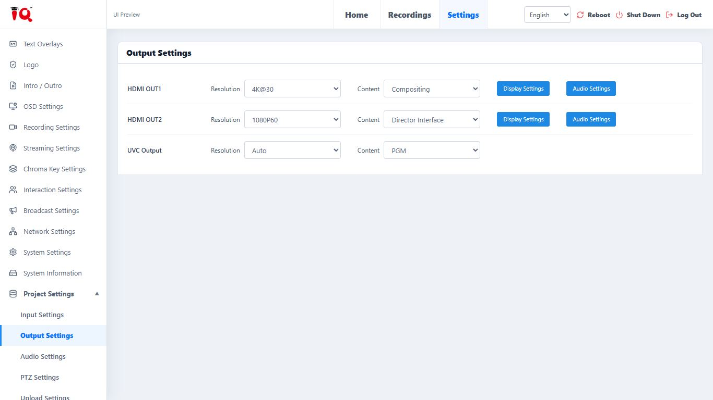
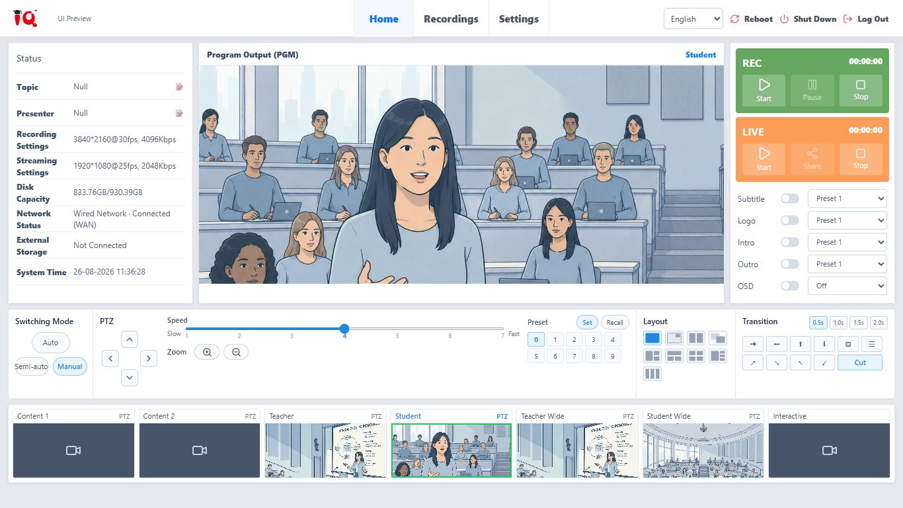
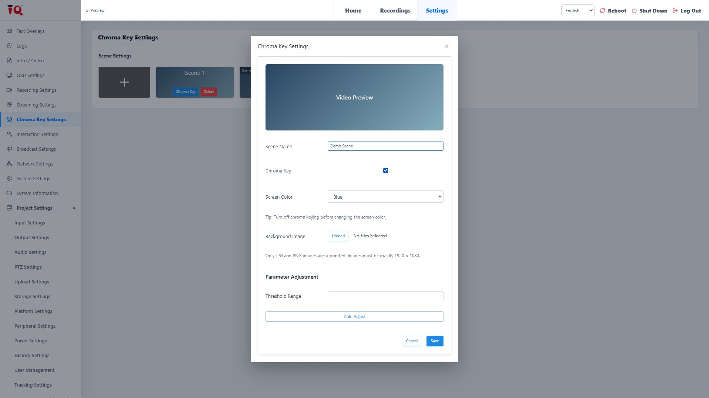

# LCS-Web V2 客户预览交接

跨项目发布及新 AI 会话请先读：[GitHub Pages 发布指南（含完整命令和新项目迁移步骤）](GITHUB-PAGES-PUBLISHING-GUIDE.md)。

## 2026-10-30 上线验收完成

[客户预览](https://toastmasterslee.github.io/q/lcs/?page=output&lang=en)已更新，公开提交 `f32ce40c089083d22265db9768c1cd64c14b1991`；[Pages 工作流](https://github.com/ToastmastersLee/q/actions/runs/40870854726)成功。7 个站点文件公网哈希匹配，6 个原有入口内容检查通过，144 个其他公开文件保持不变。线上 UVC、矩阵、中文互动分辨率及中英文切换抽查通过；Console 未见错误。详见 validation 内本次记录。

## 2026-10-29 下拉单与实机数据补齐

本轮已根据原版实机核对记录补齐 V2 选项和说明，客户文案仍采用指定 Excel。详见 [逐页清单、验证及待确认项](DEVICE-ALIGNMENT.md)。原版 108 文件用新快照保护，未改写下方 2026-10-28 的历史基线。最新发布状态见 `validation/deployment.json`；下方旧提交仅为历史记录。

## 2026-10-28 已发布至 q/lcs

正式客户预览：**[https://toastmasterslee.github.io/q/lcs/](https://toastmasterslee.github.io/q/lcs/)**。公开提交 `eccd4744cb913328ebd5f14ba8045555ac9b126e`；[Pages 工作流](https://github.com/ToastmastersLee/q/actions/runs/40667012833)成功。7 个站点文件的公网 SHA-256 全部匹配；既有 144 个公开文件 Git 对象保持不变，6 个既有入口／README 的公网字节检查通过。匿名 Chrome 已验证中英文、两个 HDMI 弹窗、导航刷新、字体、Protocol 4 和主页；原架构图主页正常。

发布仅新增 q/main 的 `lcs/`，不改变 `/q/` 架构图或原 LCS 2D/3D 路径。`/q/lcs` 会自动跳转至 `/q/lcs/`。证据保存在源码仓库 `docs/lcs-web-v2/validation/` 的 deployment、public-file-verification、public-browser-verification JSON。


2026-10-28。新版根据原厂最新 Excel 的 C/D/E 列生成中英文，供客户确认 UI 文案。代码基于旧版复制，保留原有菜单和视觉结构。

## 启动与发布

在 `Q-NEX-mockup_generator` 仓库根目录运行：

```powershell
npm ci
npm run dev:lcs-web-v2
```

新版默认 `http://localhost:5180/?page=main&lang=en`，输出设置为 `?page=output&lang=en`。顶部语言选择和系统设置语言选择使用同一语言状态。语言存储键为 `lcs_web_v2_lang`，与旧版独立。菜单切换同步 `page` 参数，支持刷新和浏览器返回。

```powershell
npm run check:lcs-web-v2
npm run build:lcs-web-v2
npm run preview:lcs-web-v2
```

构建文件位于 `dist/lcs-web-v2/`，本地构建预览默认端口 4180。本轮同时生成 `dist/lcs-web-v2-pages.zip`（站点文件位于 ZIP 根目录，约 6.3 MiB）；再次构建后需要重新打包 ZIP，发布时以新构建目录为准。**GitHub Pages 的站点根目录应放该目录内的 `index.html` 与 `assets/`**，不能只上传源码，也不要把整个仓库或整个 dist 当作新版发布包。所有构建资源使用相对路径，可放在 `https://用户名.github.io/仓库名/`。站点地址末尾保留 `/`，之后追加查询参数。

如使用现有 Pages 工作流，将构建命令设为 `npm ci`、`npm run build:lcs-web-v2`，上传目录设为 `dist/lcs-web-v2`。如从发布分支提供静态文件，只复制此目录内容。现沿用 q/main 的既有 Pages 配置，仅新增 lcs/ 子站；未新增自动部署流程。

产物中的构建插件检查模块来源，发现旧版或其他 mockup 被带入时构建直接失败。Excel、内部核查资料及 Python 导入工具不进入客户包。

## 旧版保留

- 原目录 `src/mockups/lcs-web` 的 107 个文件保持原始字节，校验基线见 `legacy-baseline.json`。
- 原 `npm run dev:lcs-web` 继续使用 5176；原构建配置未修改。
- 新版为 `src/mockups/lcs-web-v2`，独立入口为 `previews/lcs-web-v2`，独立 Vite 配置为 `vite.lcs-web-v2.config.js`。
- 开始时 Git HEAD 为 `0c405dd829c834cd3a37e45728e09f2faf894de3`。本轮未创建提交。

## Excel 更新流程

源文件为 `嵌入式录播系统_WebUI_中英文词条对照表_按页面整理版.xlsx`。本轮 SHA-256：

```text
d3b1feb42e3d1adcf8df668d99744a9906147f8659c5c8c0d7beb6dce0ac47a3
```

38 个页面块，1,476 个唯一原厂 key：582 条修改、871 条保留、23 条待确认。**英文 = E 有内容则取 E，否则取 D；中文 = C**。待确认项不使用 F 列的候选译文。工作簿保持不变。

```powershell
python scripts/lcs-web-v2/import_excel.py "最新词条表.xlsx"
python scripts/lcs-web-v2/generate_catalog.py
npm run check:lcs-web-v2
npm run build:lcs-web-v2
```

导入仅使用 Python 标准库，读取 XLSX，不写回工作簿。日常 npm 运行与构建使用已提交的语言 JSON，无需 Python 或原始 Excel。

- `catalog/`：按原厂页面拆分的完整来源，包含 key、Excel 行号、原文、最终译文、备注、审阅状态。
- `bindings/`：按 mockup 页面维护的明确 key 对应，不在运行时模糊匹配或全局替换文字。
- `supplementary/`：Excel 未覆盖的完整导航、组合提示、演示状态，分别记录中英文及原因。
- `coverage/`：1,476 条原厂 key 对应的注册位置；空数组表示尚无对应控件，不代表漏审或已实现。
- `coverage.json`：710 个注册位置使用 Excel，另有 151 个辅助文案位置；对应 595 个不同的原厂 key。**注册不等于已在页面显示**，包括预留词条及原有别名；未实现整页也不因词条已导入而变成已实现。
- `source.json`：源文件名、哈希、导入时间与总数。

新增或改动映射后重新生成 JSON。导入后如原厂删除了被引用的 key，生成器先检查整套映射，再报错退出，避免悄悄回退成其他英文。不要直接编辑生成的运行时语言 JSON。

## 已补齐与明确缺口

见 [菜单与补全记录](MENU-COVERAGE.md)。主要增加六种字体、左右滚动、Protocol 4、显示超时的 2/15 分钟、HDMI 信号开机、定时上传时间字段，以及用户管理和基础抠像弹窗。

保持短标签：`Semi-auto`、`Auto`、`REC`、`LIVE`、`Set`、`Recall`。输出菜单分别显示 `Compositing`、`PGM`、`Director Interface`；显示设置中的视频层仍为 `Film Video`。这几项根据不同原厂 key 取值，不能机械合并。

分辨率和部分时长列表仍沿用旧版可见选项，原因与缺口逐项登记。IPC/USB 为动态设备列表，当前保留空状态。V3 已明确独立 Board 源不适用于 LCS810：保留灰色的历史行、禁用对应条件，源对中不提供 Board 组合。此改动仅限新版。

预览使用本地组件状态，不控制真实设备。文件上传仅在浏览器中读取；用户密码不会保存至本地存储。抠像预览、跟踪、录制/直播和网络检测为 UI 演示，不包含实际媒体处理。默认演示名称会随语言切换，用户输入内容保持原样；页面跳转或刷新后参数可能回到演示默认值。

## 验证与截图

已完成 28 个页面 × 中英文 × 两种尺寸的 112 组检查，覆盖 1920×1080、1366×768；再对实际静态产物在 `/customer-preview/` 子路径下完成同一组检查。结果见 `validation/browser.json` 与 `validation/pages/`，无页面异常、缺失翻译、外部请求、破损图片、重复选项值或按钮横向截断。

另测：两个 HDMI 输出的显示/音频弹窗、两个显示标签页、四个滑杆；字体和滚动方向；两路 Protocol 4；用户添加及密码校验、在线详情、密码弹窗；抠像颜色锁定；菜单链接、刷新、浏览器返回。源码检查与局部 ESLint 通过。7 类交互场景包含定时上传与长选项展开；旧版 5176 页面已单独打开验证。旧版 107 文件哈希未变，详见 `validation/integrity.json`。

截图来自**本仓库新版源码运行后的真实浏览器**，2026-10-28 采集，并非原厂固件截图。自动化使用任务独立的无头 Chrome，不依赖用户当前 Chrome 窗口。新代码未提交，版本由以上父提交、源表哈希及本目录变更共同标识。内嵌图片按 50% 显示，不改变原像素。







浏览器回归脚本 `scripts/lcs-web-v2/check-browser.mjs` 需要 Playwright 与 Chrome；默认加载环境中的 Playwright，也可用 `LCS_PLAYWRIGHT_MODULE` 指定其入口 URL。`LCS_PREVIEW_URL` 可指定运行地址，例如 `http://127.0.0.1:4180/customer-preview/`。普通使用者只需上面的 npm 启动和构建命令。

## 当前停点与接续提示

当前停在**用户／客户预览审核**；站点已发布至 /q/lcs/，原厂尚未改代码，23 个翻译疑点未获确认。后续先处理客户对实际控件的反馈，再更新对应 Excel、bindings 或 supplementary，并重新生成和核验。不要修改旧版来同步新建议。

可粘贴到新聊天：

> 继续 Q-NEX-mockup_generator 的 LCS-Web V2 客户预览。先读 docs/lcs-web-v2/README.md、MENU-COVERAGE.md、source.json 和当前页面的 bindings/supplementary。原版 src/mockups/lcs-web 按 validation/original-alignment-baseline.json 的当前 108 文件快照保护；legacy-baseline.json 的 107 文件记录是历史快照，不要重写。新版在 src/mockups/lcs-web-v2。英文采用最新 Excel E 非空则 E、否则 D，中文 C，保留短按钮及 pending 原文。运行 npm run dev:lcs-web-v2（5180）；构建 npm run build:lcs-web-v2，产物 dist/lcs-web-v2，仅包含新版。当前站点已发布至 https://toastmasterslee.github.io/q/lcs/，待用户/客户 review，未提交原厂。逐页按反馈修改，不重做无关整页，不将缺少的硬件能力凭空补入。

## 后续定向部署 lcs/ 子站

在已有构建、核验和 release.json 的前提下，使用 `scripts/lcs-web-v2/deploy_pages.py` 准备独立 checkout，检查只涉及 lcs/ 的暂存差异；再用 `--publish --checkout "准备返回的目录"` 正常提交与推送。随后运行 `scripts/lcs-web-v2/verify_pages.py` 验证该提交的 Pages 工作流、公网文件和既有入口，最后执行 `check-public.mjs` 做定向浏览器抽查。

SSH 使用当前机器本来就有的 GitHub 身份。此机器使用 Windows OpenSSH 和 github-work，进程内 GIT_SSH_COMMAND 的成功配置见架构项目 Emulators/PUBLISH_HANDOFF.md；其他机器应使用其已授权身份，不复制密钥、不改全局配置。部署脚本只发布 lcs/，远端 main 若发生变化就停止，不强推。

架构项目 `SystemArchitecture/tools/publish_pages.py` 已增加 lcs/ 保留规则，并在克隆时设置 core.autocrlf=false，避免后续架构更新改动独立子站。本仓库的 LCS 原版、V2、核验工具和发布记录已推送至源码仓库 main，提交 9bad74568405bb05ef5ced986b4986f0afb12259。架构仓库的保留规则需另查其当前 Git 状态，不能由本仓库推送结果推断；换机器时同时核对这两处。公开站点发布记录见 validation/deployment.json。
